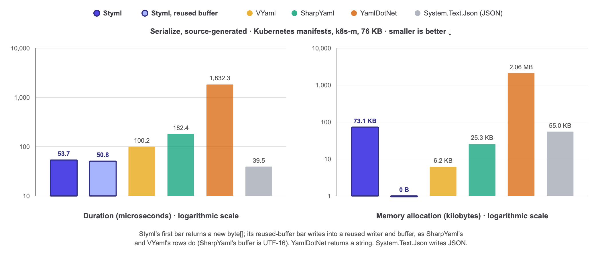

# Styml

**The System.Text.Json API, for YAML.**

Styml is a YAML 1.2 library for .NET: a reader, a writer, a document model and a serializer with reflection and source
generation. It is System.Text.Json's code and API, carried over to YAML, so code written against System.Text.Json reads
the same with `Yaml` in place of `Json`.

```csharp
using System.Text.Yaml;
using System.Text.Yaml.Serialization;

var service = new Service("web", "nginx:1.27", [80, 443], new() { ["TIER"] = "front", ["REPLICAS"] = "3" });

string yaml = YamlSerializer.Serialize(service);
// Name: web
// Image: nginx:1.27
// Ports:
// - 80
// - 443
// Environment:
//   TIER: front
//   REPLICAS: "3"

Service? back = YamlSerializer.Deserialize<Service>(yaml);

// The same with a source-generated context, for trimming and Native AOT.
string generated = YamlSerializer.Serialize(service, AppYamlContext.Default.Service);

public record Service(string Name, string Image, int[] Ports, Dictionary<string, string> Environment);

[YamlSerializable(typeof(Service))]
internal partial class AppYamlContext : YamlSerializerContext;
```

`"3"` is quoted because a plain `3` would read back as a number; the writer quotes exactly what YAML would otherwise
resolve to another type.

## Relationship with System.Text.Json

Styml is a clone of System.Text.Json from [dotnet/runtime](https://github.com/dotnet/runtime) at tag `v11.0.0`
(commit `deae2e32bf0e`), renamed and adapted to YAML 1.2. The import, the rename and every local change are recorded in
[UPSTREAM.md](UPSTREAM.md).

- **The same API shape:** `YamlSerializer`, `YamlSerializerOptions`, `Utf8YamlReader`, `Utf8YamlWriter`,
  `YamlDocument` and `YamlElement`, `YamlNode` and its `YamlObject`, `YamlArray` and `YamlValue`, `YamlConverter<T>`,
  the contract model (`YamlTypeInfo`, resolvers, modifiers), naming policies, polymorphism attributes, and the source
  generator (`YamlSerializerContext`, `[YamlSerializable]`, `[YamlSourceGenerationOptions]`).
- **The namespace is `System.Text.Yaml`**, in the `Styml` package and assembly, so it sits next to System.Text.Json in
  the same application without conflict.
- **What YAML adds:**
  - anchors and aliases, read everywhere and written by `ReferenceHandler.Preserve` (in place of `$id` and `$ref`),
    with bounds on alias expansion;
  - tags, including tag-based polymorphism (`[YamlTagMapping]`) and `%TAG` directives (at most 256 per document);
  - block and flow styles, scalar styles (plain, single-quoted, double-quoted, literal, folded) per member or by
    default, and comments written from `[YamlComment]`;
  - schemas: the YAML 1.2 core schema by default, the JSON and failsafe schemas, and an opt-in YAML 1.1 schema;
  - merge keys (`<<`), opt-in;
  - collection keys (`? [a, b]: v`) in the DOM and the serializer;
  - multi-document streams (`---`), and the duplicate-key policy (an error by default, as YAML requires).
- **What differs from System.Text.Json:**
  - the writer writes block-style YAML by default; a JSON-compatible style is an option (`YamlWriterOptions.Style`);
  - the reader reads YAML 1.2, of which JSON is a subset: a plain scalar is text until a typed read asks for a number
    or a boolean, empty input reads as no value, and several top-level values are documents;
  - the APIs that were obsolete upstream (`IgnoreNullValues`, `AddContext`) are removed.

Styml is an independent project. It is not a Microsoft or .NET Foundation product, and it is not supported by them.
Most of its code is System.Text.Json's, under the MIT license of the .NET Foundation and its contributors; see
[LICENSE](LICENSE) and [THIRD-PARTY-NOTICES.txt](THIRD-PARTY-NOTICES.txt).

## Usage

- [Serialize and deserialize](#serialize-and-deserialize)
- [Choose the output](#choose-the-output)
- [Scalar styles and quoting](#scalar-styles-and-quoting)
- [Comments, order and omitted members](#comments-order-and-omitted-members)
- [Schemas and typed reads](#schemas-and-typed-reads)
- [Duplicate keys and empty input](#duplicate-keys-and-empty-input)
- [Anchors and aliases](#anchors-and-aliases)
- [Merge keys](#merge-keys)
- [Tags and polymorphism](#tags-and-polymorphism)
- [Collection keys](#collection-keys)
- [Several documents in one stream](#several-documents-in-one-stream)
- [The DOM](#the-dom)
- [The reader and the writer](#the-reader-and-the-writer)
- [JSON](#json)
- [Options reference](docs/options.md)

Every sample below is a test (`test/Styml.Yaml.Tests/Readme`) and its output is the one the test checks. The samples
use these types:

<!-- sample:types -->
```csharp
public record Service(string Name, string Image, int[] Ports, Dictionary<string, string> Environment);

[YamlSerializable(typeof(Service))]
[YamlSourceGenerationOptions(PropertyNamingPolicy = YamlKnownNamingPolicy.CamelCase, IndentSequences = true)]
public partial class AppYamlContext : YamlSerializerContext;
```
<!-- /sample:types -->

The writer ends lines with `Environment.NewLine` unless `NewLine` is set; the outputs are shown with `\n`.

### Serialize and deserialize

`YamlSerializer` has the methods of `JsonSerializer`: `Serialize`, `Deserialize`, `SerializeToUtf8Bytes`, the stream,
`PipeReader` and async overloads, and `DeserializeAsyncEnumerable`. With reflection:

<!-- sample:reflection -->
```csharp
string yaml = YamlSerializer.Serialize(service);
Service back = YamlSerializer.Deserialize<Service>(yaml)!;
```

```yaml
Name: web
Image: nginx:1.27
Ports:
- 80
- 443
Environment:
  TIER: front
  REPLICAS: "3"
```
<!-- /sample:reflection -->

With a source-generated context, for trimming and Native AOT. `[YamlSourceGenerationOptions]` takes System.Text.Json's
options and the YAML ones (`WriteStyle`, `IndentSequences`, `Schema`, `DuplicateKeyHandling` and the others in the
[options reference](docs/options.md)):

<!-- sample:source-generated -->
```csharp
string yaml = YamlSerializer.Serialize(service, AppYamlContext.Default.Service);
Service back = YamlSerializer.Deserialize(yaml, AppYamlContext.Default.Service)!;
```

```yaml
name: web
image: nginx:1.27
ports:
  - 80
  - 443
environment:
  TIER: front
  REPLICAS: "3"
```
<!-- /sample:source-generated -->

Streams and async work as with System.Text.Json:

<!-- sample:streams -->
```csharp
using var stream = new MemoryStream();
await YamlSerializer.SerializeAsync(stream, service);
stream.Position = 0;
Service? back = await YamlSerializer.DeserializeAsync<Service>(stream);
```

```text
web: 2 ports
```
<!-- /sample:streams -->

### Choose the output

Block style is the default. `WriteStyle = YamlWriterStyle.JsonCompatible` writes JSON instead, which `WriteIndented`
formats as System.Text.Json does; block YAML is always written on lines, with `IndentSize` (2 by default, at least 2)
and `IndentSequences` (a sequence under a key at the key's column by default):

<!-- sample:output-styles -->
```csharp
var json = new YamlSerializerOptions { WriteStyle = YamlWriterStyle.JsonCompatible, WriteIndented = true };
var indented = new YamlSerializerOptions { IndentSequences = true, IndentSize = 4 };
string output = YamlSerializer.Serialize(value, json) + "\n" + YamlSerializer.Serialize(value, indented);
```

```text
{
  "Name": "web",
  "Ports": [
    80,
    443
  ],
  "Env": {
    "Tier": "front"
  }
}
Name: web
Ports:
    - 80
    - 443
Env:
    Tier: front
```
<!-- /sample:output-styles -->

A mapping that is a sequence item starts on the dash's line; `ExpandSequenceItems` puts it on the next line:

<!-- sample:expanded-items -->
```csharp
string compact = YamlSerializer.Serialize(value);
string expanded = YamlSerializer.Serialize(value, new YamlSerializerOptions { ExpandSequenceItems = true });
```

```yaml
- Name: a
  Port: 80
- Name: b
  Port: 81

-
  Name: a
  Port: 80
-
  Name: b
  Port: 81
```
<!-- /sample:expanded-items -->

`MaxLineWidth` folds plain and double-quoted scalars at a space past the width, and continues a flow collection on a
new line; 0, the default, folds nothing:

<!-- sample:line-width -->
```csharp
var value = new
{
    Description = "A long description that goes on well past the width the writer is given, so it folds.",
    Tags = new[] { "alpha", "beta", "gamma", "delta", "epsilon", "zeta", "eta", "theta" },
};
var options = new YamlSerializerOptions { MaxLineWidth = 40 };
string yaml = YamlSerializer.Serialize(value, options);
string flow = YamlNode.Parse("tags: [alpha, beta, gamma, delta, epsilon, zeta, eta, theta]")!.ToYamlString(options);
```

```yaml
Description: A long description that
  goes on well past the width the writer
  is given, so it folds.
Tags:
- alpha
- beta
- gamma
- delta
- epsilon
- zeta
- eta
- theta

tags: [alpha, beta, gamma, delta, epsilon,
  zeta, eta, theta]
```
<!-- /sample:line-width -->

`NewLine` sets the line break, `"\n"` or `"\r\n"`:

<!-- sample:new-line -->
```csharp
var options = new YamlSerializerOptions { NewLine = "\r\n" };
string yaml = YamlSerializer.Serialize(new { A = 1, B = 2 }, options);
bool crlf = yaml == "A: 1\r\nB: 2\r\n";
```
<!-- /sample:new-line -->

### Scalar styles and quoting

A string is written plain unless a YAML reader would read it as something else, or the syntax requires quotes: a
YAML 1.2 core value (`3`, `true`, `null`), a YAML 1.1 value (`yes`, a date), an indicator at the start, `: ` or ` #`
inside. Those are double-quoted. `QuoteForLenientReaders` also quotes what some readers resolve although no standard
does, such as Ruby's Psych reading `nan`:

<!-- sample:quoting -->
```csharp
var values = new Dictionary<string, string>
{
    ["text"] = "plain text",
    ["number"] = "3",
    ["boolean"] = "true",
    ["yaml11"] = "yes",
    ["null"] = "null",
    ["date"] = "2001-12-14",
    ["indicator"] = "- dash",
    ["colon"] = "a: b",
    ["comment"] = "a #b",
};
string yaml = YamlSerializer.Serialize(values);
string lenient = YamlSerializer.Serialize(new[] { "nan", "Infinity" }, new YamlSerializerOptions { QuoteForLenientReaders = true });
```

```yaml
text: plain text
number: "3"
boolean: "true"
yaml11: "yes"
"null": "null"
date: "2001-12-14"
indicator: "- dash"
colon: "a: b"
comment: "a #b"

- nan
- Infinity

- "nan"
- "Infinity"
```
<!-- /sample:quoting -->

A string with a line break is a literal block scalar by default (`MultiLineStringStyle`: `Literal`, `Folded` or
`DoubleQuoted`). `[YamlScalarStyle]` sets one member's style, `DefaultScalarStyle` every other string's; a style that
cannot hold the text gives way to the writer's own choice, and a literal or folded style applies to a string with a
line break only:

<!-- sample:styled -->
```csharp
public class Note
{
    public string Title { get; set; } = "";

    [YamlScalarStyle(YamlScalarStyle.Folded)]
    public string Summary { get; set; } = "";

    public string Body { get; set; } = "";

    public string Signature { get; set; } = "";
}
```
<!-- /sample:styled -->

<!-- sample:scalar-styles -->
```csharp
var note = new Note
{
    Title = "Release",
    Summary = "A summary on two lines\nthat a folded scalar keeps.",
    Body = "line one\nline two\n",
    Signature = "the team",
};
string literal = YamlSerializer.Serialize(note);
string singleQuoted = YamlSerializer.Serialize(note, new YamlSerializerOptions { DefaultScalarStyle = YamlScalarStyle.SingleQuoted });
```

```yaml
Title: Release
Summary: >-
  A summary on two lines

  that a folded scalar keeps.
Body: |
  line one
  line two
Signature: the team

Title: 'Release'
Summary: >-
  A summary on two lines

  that a folded scalar keeps.
Body: 'line one

  line two

  '
Signature: 'the team'
```
<!-- /sample:scalar-styles -->

### Comments, order and omitted members

`[YamlComment]` writes a comment line above a member, in block style. `MappingOrder = Sorted` writes an object's members
by `[YamlPropertyOrder]`, then by name in ordinal order; dictionaries keep their own order.
`YamlIgnoreCondition.WhenWritingEmptyCollection` leaves out null values and empty collections, as YamlDotNet's
`OmitNull | OmitEmptyCollections` does:

<!-- sample:comments -->
```csharp
public class Settings
{
    [YamlComment("How many workers to start.")]
    public int Workers { get; set; } = 4;

    public List<string> Hosts { get; set; } = [];

    public string? Region { get; set; }

    public string Name { get; set; } = "api";
}
```
<!-- /sample:comments -->

<!-- sample:comments-order -->
```csharp
var options = new YamlSerializerOptions
{
    MappingOrder = YamlMappingOrder.Sorted,
    DefaultIgnoreCondition = YamlIgnoreCondition.WhenWritingEmptyCollection,
};
string yaml = YamlSerializer.Serialize(new Settings(), options);
```

```yaml
Name: api
# How many workers to start.
Workers: 4
```
<!-- /sample:comments-order -->

### Schemas and typed reads

`Schema` decides what a plain scalar is when it is read into `object` (or a `YamlElement`, a `YamlNode`): the YAML 1.2
core schema by default; `Yaml11` adds YAML 1.1's booleans (`yes`, `on`), octal with a leading zero (`012`), binary,
sexagesimal and `_` separated numbers; `Json` reads only JSON's values and refuses any other plain scalar; `Failsafe`
reads every scalar as a string:

<!-- sample:schemas -->
```csharp
string yaml = "a: 12\nb: yes\nc: 0x1F\nd: ~\ne: 1_000\nf: 0b101\ng: 012\n";
string Read(YamlSchemaKind schema) => Describe(() =>
    YamlSerializer.Serialize(YamlSerializer.Deserialize<Dictionary<string, object?>>(yaml, new YamlSerializerOptions { Schema = schema }),
        new YamlSerializerOptions { WriteStyle = YamlWriterStyle.JsonCompatible }));
string output = string.Join("\n", new[] { YamlSchemaKind.Core, YamlSchemaKind.Yaml11, YamlSchemaKind.Json, YamlSchemaKind.Failsafe }
    .Select(schema => $"{schema}: {Read(schema)}"));
```

```text
Core: {"a":12,"b":"yes","c":31,"d":null,"e":"1_000","f":"0b101","g":12}
Yaml11: {"a":12,"b":true,"c":31,"d":null,"e":1000,"f":5,"g":10}
Json: YamlException: The plain scalar 'yes' is not null, a boolean or a number of the JSON schema (YamlSchemaKind.Json); quote it to read a string. Path: $.b | LineNumber: 1 | BytePositionInLine: 6.
Failsafe: {"a":"12","b":"yes","c":"0x1F","d":"~","e":"1_000","f":"0b101","g":"012"}
```
<!-- /sample:schemas -->

A typed member reads its own type: a plain `12`, `0o14` or `0xC` into an `int`, any scalar into a `string`, and a
number into `object` as a `YamlElement`. A quoted `'12'` is a string, so it does not read into an `int` unless
`AcceptLenientScalars` is set, which accepts the forms other YAML libraries resolve although no standard does:

<!-- sample:typed-scalars -->
```csharp
var plain = YamlSerializer.Deserialize<Dictionary<string, int>>("a: 12\nb: 0o14\nc: 0xC\n")!;
string quoted = Describe(() => YamlSerializer.Deserialize<Dictionary<string, int>>("a: '12'\n"));
string lenient = Describe(() => YamlSerializer.Deserialize<Dictionary<string, int>>("a: '12'\n",
    new YamlSerializerOptions { AcceptLenientScalars = true })!["a"]);
string text = YamlSerializer.Deserialize<Dictionary<string, string>>("a: 12\nb: true\n")!["b"];
object number = YamlSerializer.Deserialize<Dictionary<string, object>>("a: 12\n")!["a"];
```

```text
12, 12, 12
quoted: YamlException: The YAML value could not be converted to System.Int32. Path: $.a | LineNumber: 0 | BytePositionInLine: 7.
lenient: 12
string: true
object: YamlElement 12
```
<!-- /sample:typed-scalars -->

### Duplicate keys and empty input

A mapping key that appears twice is an error by default, as YAML 1.2 requires; `DuplicateKeyHandling` can keep the last
or the first. Empty input, or input with only comments, reads as null:

<!-- sample:duplicate-keys -->
```csharp
string yaml = "a: 1\na: 2\n";
string error = Describe(() => YamlSerializer.Deserialize<Dictionary<string, int>>(yaml));
int last = YamlSerializer.Deserialize<Dictionary<string, int>>(yaml,
    new YamlSerializerOptions { DuplicateKeyHandling = YamlDuplicateKeyHandling.LastWins })!["a"];
int first = YamlSerializer.Deserialize<Dictionary<string, int>>(yaml,
    new YamlSerializerOptions { DuplicateKeyHandling = YamlDuplicateKeyHandling.FirstWins })!["a"];
Service? empty = YamlSerializer.Deserialize<Service>("# nothing but a comment\n");
```

```text
Error: YamlException: Duplicate properties not allowed during deserialization.
LastWins: 2
FirstWins: 1
empty input: null
```
<!-- /sample:duplicate-keys -->

### Anchors and aliases

Aliases are always read: an alias to an object or a collection shares the instance read at its anchor.
`ReferenceHandler.Preserve` writes an anchor for each object or collection referenced more than once, and
`ReferenceHandler.PreserveAll` for every one:

<!-- sample:anchors-types -->
```csharp
public class Node
{
    public string Name { get; set; } = "";
    public Node? Next { get; set; }
    public List<string>? Labels { get; set; }
}
```
<!-- /sample:anchors-types -->

<!-- sample:anchors -->
```csharp
var labels = new List<string> { "blue", "green" };
var shared = new Node { Name = "shared", Labels = labels };
var root = new Node { Name = "root", Next = shared, Labels = labels };
var options = new YamlSerializerOptions { ReferenceHandler = ReferenceHandler.Preserve };
string yaml = YamlSerializer.Serialize(root, options);
Node back = YamlSerializer.Deserialize<Node>(yaml)!;
bool sameList = ReferenceEquals(back.Labels, back.Next!.Labels);
```

```text
Name: root
Next:
  Name: shared
  Next: null
  Labels: &1
  - blue
  - green
Labels: *1

same list after reading: True
```
<!-- /sample:anchors -->

An alias read into a scalar, a value type or `object` copies the anchored node. `MaxAliasExpansion` bounds those copies
(by default 10,000 nodes, or the input's size in bytes when that is more), so a document of nested aliases cannot
expand without limit:

<!-- sample:alias-bound -->
```csharp
string bomb = "a: &a [x, x, x, x, x, x, x, x, x, x]\nb: &b [*a, *a, *a, *a, *a, *a, *a, *a, *a, *a]\n"
    + "c: &c [*b, *b, *b, *b, *b, *b, *b, *b, *b, *b]\nd: [*c, *c, *c, *c, *c, *c, *c, *c, *c, *c]\n";
string error = Describe(() => YamlSerializer.Deserialize<Dictionary<string, object>>(bomb,
    new YamlSerializerOptions { MaxAliasExpansion = 1000 }));
```

```text
YamlException: Reading YAML aliases would copy more than 1000 nodes (YamlSerializerOptions.MaxAliasExpansion).
```
<!-- /sample:alias-bound -->

### Merge keys

`ResolveMergeKeys` merges a `<<` key's mappings into the mapping that holds it (YAML 1.1's merge type); the mapping's own
keys win. It is off by default, so `<<` is an ordinary key:

<!-- sample:merge-keys -->
```csharp
string yaml = """
    defaults: &defaults
      image: nginx:1.27
      restart: always
    web:
      <<: *defaults
      restart: never
    """;
var options = new YamlSerializerOptions { ResolveMergeKeys = true };
var config = YamlSerializer.Deserialize<Dictionary<string, Dictionary<string, string>>>(yaml, options)!;
string web = string.Join(", ", config["web"].Select(p => $"{p.Key}={p.Value}"));
```

```text
image=nginx:1.27, restart=never
```
<!-- /sample:merge-keys -->

### Tags and polymorphism

`[YamlPolymorphic(DiscriminatorStyle = ...)]` chooses how a hierarchy writes its derived types: `Property` (the
default, a `$type` member as System.Text.Json writes), `Tag` (a YAML tag) or `Both`. Under `Tag` and `Both` each derived
type needs a type discriminator, which the JSON-compatible style writes as `$type`; its tag is `!` followed by the
discriminator unless `Tag` sets another. Reading accepts the `$type` member under every style:

<!-- sample:polymorphism-types -->
```csharp
[YamlPolymorphic(DiscriminatorStyle = YamlTypeDiscriminatorStyle.Tag)]
[YamlDerivedType(typeof(Circle), "circle")]
[YamlDerivedType(typeof(Square), "square", Tag = "!box")]
public abstract class Shape;

public class Circle : Shape { public double Radius { get; set; } }

public class Square : Shape { public double Side { get; set; } }
```
<!-- /sample:polymorphism-types -->

<!-- sample:polymorphism -->
```csharp
Shape[] shapes = [new Circle { Radius = 1.5 }, new Square { Side = 2 }];
string yaml = YamlSerializer.Serialize(shapes);
Shape[] back = YamlSerializer.Deserialize<Shape[]>(yaml)!;
string types = string.Join(", ", back.Select(s => s.GetType().Name));
```

```text
- !circle
  Radius: 1.5
- !box
  Side: 2

Circle, Square
```
<!-- /sample:polymorphism -->

Outside a hierarchy, `TagMappings` (or `[YamlTagMapping]` on a context) maps a tag to a type: an explicit allow-list.
A tag never names a .NET type: an unmapped tag is read as data, and no type is loaded:

<!-- sample:tag-mappings -->
```csharp
var options = new YamlSerializerOptions();
options.TagMappings.Add("!circle", typeof(Circle));
object? mapped = YamlSerializer.Deserialize<object>("!circle {Radius: 3}", options);
string unknown = Describe(() => YamlSerializer.Deserialize<object>("!System.IO.FileInfo {}", options)!.GetType().Name);
```

```text
mapped: Circle
unmapped type name: YamlElement
```
<!-- /sample:tag-mappings -->

### Collection keys

A flow collection can be a mapping key, implicitly (`[c, d]: v`) or explicitly (`? [a, b]`). It reads into a dictionary
whose key type is a collection, and `YamlProperty.KeyKind`, `YamlObject.CollectionKeys` and `Utf8YamlReader.KeyKind`
expose it. `DisallowImplicitCollectionKeys` turns the implicit form off, so that a stream of flow collections (JSON
lines, for example) yields each one as soon as it is complete:

<!-- sample:collection-keys -->
```csharp
string yaml = "? [a, b]\n: pair\n[c, d]: implicit\nplain: text\n";
var dictionary = YamlSerializer.Deserialize<Dictionary<List<string>, string>>("? [a, b]\n: pair\n")!;
using YamlDocument document = YamlDocument.Parse(yaml);
string kinds = string.Join(", ", document.RootElement.EnumerateObject().Select(p => p.KeyKind));
var node = YamlNode.Parse(yaml)!.AsObject();
var jsonStream = new YamlSerializerOptions { DisallowImplicitCollectionKeys = true };
int[] numbers = YamlSerializer.Deserialize<int[]>("[1, 2, 3]", jsonStream)!;
```

```text
dictionary key: [a, b]
key kinds: Complex, Complex, Scalar
string keys: 1, collection keys: 2
without implicit collection keys: 3 numbers
```
<!-- /sample:collection-keys -->

### Several documents in one stream

A YAML stream holds documents separated by `---`. `DeserializeAsyncEnumerable` with `topLevelValues: true` reads one
value per document, and `SerializeAsyncEnumerable` writes `---` between them; `YamlReaderOptions.AllowMultipleValues`
lets the reader continue past the first document:

<!-- sample:documents -->
```csharp
string yaml = "a: 1\n---\na: 2\n---\na: 3\n";
var values = new List<int>();
using var stream = new MemoryStream(Encoding.UTF8.GetBytes(yaml));
await foreach (var item in YamlSerializer.DeserializeAsyncEnumerable<Dictionary<string, int>>(stream, topLevelValues: true))
{
    values.Add(item!["a"]);
}

var output = new MemoryStream();
await YamlSerializer.SerializeAsyncEnumerable(output, Items(), topLevelValues: true);
static async IAsyncEnumerable<object> Items()
{
    yield return new { a = 1 };
    yield return new { a = 2 };
    await Task.CompletedTask;
}
```

```text
read: 1, 2, 3
written:
a: 1
---
a: 2
```
<!-- /sample:documents -->

### The DOM

`YamlNode` (`YamlObject`, `YamlArray`, `YamlValue`) and the read-only `YamlDocument` parse YAML and keep its scalar and
collection styles, anchors and tags in their order, numbers as written (`0x1F`, `0777`) and empty values, so an edited
document is written back in its own styles and text (comments are not kept):

<!-- sample:dom -->
```csharp
YamlNode root = YamlNode.Parse("""
    name: web   # not kept
    ports: [80, 443]
    note: 'kept quoted'
    """)!;
root["ports"]!.AsArray().Add(8080);
root["replicas"] = 3;
string edited = root.ToYamlString();
```

```yaml
name: web
ports: [80, 443, 8080]
note: 'kept quoted'
replicas: 3
```
<!-- /sample:dom -->

`CollectionStyle` sets a collection's style. `IgnoreSourceStyles` writes a parsed document in the options' styles
instead, so JSON read in comes out as block YAML:

<!-- sample:dom-styles -->
```csharp
YamlNode fromJson = YamlNode.Parse("""{"name": "web", "ports": [80, 443]}""")!;
string asIs = fromJson.ToYamlString();
string block = fromJson.ToYamlString(new YamlSerializerOptions { IgnoreSourceStyles = true });
YamlObject created = new() { ["tags"] = new YamlArray("a", "b") };
created["tags"]!.AsArray().CollectionStyle = YamlCollectionStyle.Flow;
```

```yaml
{"name": "web", "ports": [80, 443]}

name: web
ports:
- 80
- 443

tags: [a, b]
```
<!-- /sample:dom-styles -->

### The reader and the writer

`Utf8YamlReader` reads the tokens of System.Text.Json's reader, with YAML's own information on each one: `ScalarStyle`,
`Anchor`, `Tag` (and `GetExpandedTag`), alias tokens and `KeyKind`:

<!-- sample:reader -->
```csharp
var reader = new Utf8YamlReader("base: &b !point {x: 1}\ncopy: *b\ntext: 'quoted'\n"u8);
var lines = new List<string>();
while (reader.Read())
{
    string anchor = reader.Anchor.IsEmpty ? "" : " &" + Encoding.UTF8.GetString(reader.Anchor.ToArray());
    string tag = reader.Tag.IsEmpty ? "" : " " + reader.GetExpandedTag();
    string text = reader.TokenType switch
    {
        YamlTokenType.Alias => " *" + Encoding.UTF8.GetString(reader.ValueSpan.ToArray()),
        YamlTokenType.String or YamlTokenType.PropertyName or YamlTokenType.Number => $" {reader.GetString()} ({reader.ScalarStyle})",
        _ => "",
    };
    lines.Add($"{reader.TokenType}{anchor}{tag}{text}");
}
```

```text
StartObject
PropertyName base (Plain)
StartObject &b !point
PropertyName x (Plain)
Number 1 (Plain)
EndObject
PropertyName copy (Plain)
Alias *b
PropertyName text (Plain)
String quoted (SingleQuoted)
EndObject
```
<!-- /sample:reader -->

`Utf8YamlWriter` writes block style by default, and takes comments, anchors, aliases, tags, scalar and collection
styles, directives and explicit keys:

<!-- sample:writer -->
```csharp
using var buffer = new MemoryStream();
using (var writer = new Utf8YamlWriter(buffer, new YamlWriterOptions { NewLine = "\n" }))
{
    writer.WriteStartObject();
    writer.WriteCommentValue("generated", false);
    writer.WritePropertyName("base");
    writer.WriteAnchor("b");
    writer.WriteTag("!point");
    writer.WriteStartObject();
    writer.WriteNumber("x", 1);
    writer.WriteEndObject();
    writer.WritePropertyName("copy");
    writer.WriteAliasValue("b");
    writer.WriteScalarStyle(YamlScalarStyle.SingleQuoted);
    writer.WriteString("text", "quoted");
    writer.WriteStartPropertyKey();
    writer.WriteCollectionStyle(YamlCollectionStyle.Flow);
    writer.WriteStartArray();
    writer.WriteStringValue("a");
    writer.WriteStringValue("b");
    writer.WriteEndArray();
    writer.WriteEndPropertyKey();
    writer.WriteStringValue("a collection key");
    writer.WriteEndObject();
}
string yaml = Encoding.UTF8.GetString(buffer.ToArray());
```

```yaml
# generated
base: &b !point
  x: 1
copy: *b
text: 'quoted'
? [a, b]
: a collection key
```
<!-- /sample:writer -->

### JSON

JSON is YAML 1.2, so `YamlSerializer` reads JSON text as it is, with YAML's rules: duplicate keys are an error unless
`DuplicateKeyHandling` says otherwise, `#` comments and a trailing comma in a flow collection are accepted (`AllowTrailingCommas`
is kept for source compatibility and changes nothing). `WriteStyle = JsonCompatible` writes JSON:

<!-- sample:json -->
```csharp
string json = """
    {
      "name": "web", # YAML comments are allowed
      "ports": [80, 443,],
    }
    """;
var value = YamlSerializer.Deserialize<Dictionary<string, object>>(json)!;
string jsonOut = YamlSerializer.Serialize(value, new YamlSerializerOptions { WriteStyle = YamlWriterStyle.JsonCompatible });
```

```json
{"name":"web","ports":[80,443]}
```
<!-- /sample:json -->

### Unity's YAML

Unity writes its scenes, prefabs and assets as a stream of documents: the `%YAML 1.1` and `%TAG !u!
tag:unity3d.com,2011:` header once, then one object per document, `--- !u!<class ID> &<file ID>`, and `stripped` on the
document line of a prefab's placeholder objects. Two reader options, off by default, read it:

- `InheritTagDirectives`: a document with no directives keeps the previous document's `%TAG` handles, as YAML 1.1 reads
  a stream (section 7.4); YAML 1.2 makes each document independent, so without it the second object's `!u!` is an
  undeclared handle. `%YAML 1.1` does not turn it on (YamlDotNet's parser keeps the handles under `%YAML 1.1` only,
  SharpYaml never).
- `AcceptUnityStrippedMarker`: `stripped` after a document's tag on its `---` line, reported by `IsUnityStripped` on the
  reader, `YamlElement` and `YamlNode`.

Typed models read the objects by their tags, with `TagMappings` on the expanded tags, and each document's anchor is its
file ID. Under the core schema, the default, Unity's `0` and `1` flags are numbers (`int` members) and its GUIDs, hashes
and hex blobs read as text into `string` members; `Yaml11` would read a value such as `n` or `on` as a boolean.

<!-- sample:unity-types -->
```csharp
private const string Scene = """
    %YAML 1.1
    %TAG !u! tag:unity3d.com,2011:
    --- !u!1 &1000
    GameObject:
      m_Name: Player
      m_IsActive: 1
    --- !u!4 &1001
    Transform:
      m_GameObject: {fileID: 1000}
      m_LocalPosition: {x: 0, y: 1, z: -10}
    --- !u!4 &400000 stripped
    Transform:
      m_PrefabInstance: {fileID: 100100000}

    """;

public abstract class UnityObject { }
public sealed class GameObjectDocument : UnityObject { public GameObjectData? GameObject { get; set; } }
public sealed class TransformDocument : UnityObject { public TransformData? Transform { get; set; } }
public sealed class GameObjectData { public string? m_Name { get; set; } public int m_IsActive { get; set; } }
public sealed class TransformData { public FileReference? m_GameObject { get; set; } public FileReference? m_PrefabInstance { get; set; } }
public sealed class FileReference { public long fileID { get; set; } }
```
<!-- /sample:unity-types -->

<!-- sample:unity-read -->
```csharp
var readerOptions = new YamlReaderOptions { AllowMultipleValues = true, InheritTagDirectives = true, AcceptUnityStrippedMarker = true };
var options = new YamlSerializerOptions();
options.TagMappings.Add("tag:unity3d.com,2011:1", typeof(GameObjectDocument));
options.TagMappings.Add("tag:unity3d.com,2011:4", typeof(TransformDocument));

var objects = new List<string>();
var reader = new Utf8YamlReader(Encoding.UTF8.GetBytes(Scene), readerOptions);
while (reader.Read())
{
    string fileID = Encoding.UTF8.GetString(reader.Anchor.ToArray());
    bool stripped = reader.IsUnityStripped;
    objects.Add(YamlSerializer.Deserialize<UnityObject>(ref reader, options) switch
    {
        GameObjectDocument g => $"{fileID}: GameObject {g.GameObject!.m_Name}, active {g.GameObject.m_IsActive}",
        TransformDocument { Transform.m_PrefabInstance: { } p } when stripped => $"{fileID}: stripped Transform of prefab instance {p.fileID}",
        TransformDocument t => $"{fileID}: Transform of {t.Transform!.m_GameObject!.fileID}",
        _ => fileID,
    });
}
```

```text
1000: GameObject Player, active 1
1001: Transform of 1000
400000: stripped Transform of prefab instance 100100000
```
<!-- /sample:unity-read -->

Written back through the DOM, a document keeps what it read: numbers as written, the order of a node's properties, the
root's properties on its `---` line, a tag in its shorthand where the writer's own `%TAG` directives (`WriteDirective`)
resolve it, and empty values. So a tool can change one value and write the file back with nothing else moved; the
reader does not return a stream's directives, so the tool writes the header:

<!-- sample:unity-write-back -->
```csharp
var readerOptions = new YamlReaderOptions { AllowMultipleValues = true, InheritTagDirectives = true, AcceptUnityStrippedMarker = true };
var buffer = new ArrayBufferWriter<byte>();
using (var writer = new Utf8YamlWriter(buffer, new YamlWriterOptions { InheritTagDirectives = true }))
{
    // The reader does not return a stream's directives: the header is written as Unity writes it.
    writer.WriteDirective("%YAML 1.1");
    writer.WriteDirective("%TAG !u! tag:unity3d.com,2011:");
    var reader = new Utf8YamlReader(Encoding.UTF8.GetBytes(Scene), readerOptions);
    while (reader.Read())
    {
        YamlNode node = YamlNode.Parse(ref reader)!;
        if (node["GameObject"] is YamlNode gameObject)
        {
            gameObject["m_Name"] = "Hero";
        }

        writer.WriteDocumentStart();
        node.WriteTo(writer);
    }
}

string written = Encoding.UTF8.GetString(buffer.WrittenSpan.ToArray());
```

```yaml
%YAML 1.1
%TAG !u! tag:unity3d.com,2011:
--- !u!1 &1000
GameObject:
  m_Name: Hero
  m_IsActive: 1
--- !u!4 &1001
Transform:
  m_GameObject: {fileID: 1000}
  m_LocalPosition: {x: 0, y: 1, z: -10}
--- !u!4 &400000 stripped
Transform:
  m_PrefabInstance: {fileID: 100100000}
```
<!-- /sample:unity-write-back -->

## Versions and package feeds

| Source | Purpose | Package feed |
| --- | --- | --- |
| `v*.*.*` | Versioned releases | [](https://www.nuget.org/packages/Styml) |
| `main` branch | Development previews | [](https://feedz.io/org/sebastienros/repository/styml/packages/Styml) |

For development previews, add Feedz alongside NuGet.org:

```sh
dotnet nuget add source https://f.feedz.io/sebastienros/styml/nuget/index.json --name styml-preview
dotnet add package Styml --prerelease
```

## Features

- **Serializer:** reflection and source-generated contracts, the options and attributes of System.Text.Json
  (naming policies, ignore conditions, required and init members, constructors, polymorphism, number handling,
  reference handling), async and streaming APIs, and YAML's tags, anchors, merge keys and collection keys.
- **Reader:** `Utf8YamlReader`, a forward-only reader over UTF-8 spans and multi-segment sequences, with YAML's token
  information (scalar style, anchor, tag, alias, key kind) next to System.Text.Json's.
- **Writer:** `Utf8YamlWriter`, block style by default, flow collections, scalar styles, anchors, tags, comments,
  explicit keys, and a JSON-compatible style.
- **DOM:** the read-only `YamlDocument` and the mutable `YamlNode`, which keep anchors, tags and styles for write-back.
- **YAML 1.2 conformance:** see below.

## YAML conformance

Styml runs the [yaml-test-suite](https://github.com/yaml/yaml-test-suite) (release `data-2022-01-17`, 402 cases) in
its tests:

- all **308 valid cases** are accepted, each with the suite's expected event trace (`%TAG` handles expanded);
- all **94 error cases** are rejected;
- every valid case, written back in block style, reads again with the same events.

The expectation lists in `test/Styml.Yaml.Tests/YamlTestSuite` are empty: no case is an exception.

## Target frameworks

The package targets `net11.0`, `net10.0` and `netstandard2.0` (which covers .NET Framework 4.6.2 and later). The tests
run on net11.0, net10.0 and, through the netstandard2.0 asset, net481.

## Trimming and Native AOT

On net10.0 and net11.0 the library is trimmable and AOT-compatible, with the analyzers on. With a source-generated
`YamlSerializerContext`, serialization needs no reflection; set `YamlSerializerIsReflectionEnabledByDefault` to `false`
in the project file to turn reflection-based serialization off, as with System.Text.Json.
`samples/AotSmoke` is published trimmed and as Native AOT, with warnings as errors, before every release.

## Benchmarks

Styml against YamlDotNet 18.1.0, SharpYaml 3.17.0 and VYaml 1.6.1, with System.Text.Json reading or writing the
same data as JSON as the reference. Five medium documents from `bench/corpus` (25 to 96 KB: a Compose file, Kubernetes
manifests, an OpenAPI description, a list of records, a CI workflow); .NET 11.0.0 on an Apple M4 Pro (macOS 15.8, Arm64);
BenchmarkDotNet 0.16.0-preview.2, ShortRun with 3 launches; run on 2026-11-23 on the published commit. The charts and
the first two tables are the Kubernetes manifests (`k8s-m`, 76 KB).

<!-- panel:charts -->





<!-- /panel:charts -->

<!-- panel:pivot -->
Mean time on k8s-m (microseconds; smaller is better):

| Scenario | Styml | VYaml | SharpYaml | YamlDotNet | System.Text.Json |
| --- | ---: | ---: | ---: | ---: | ---: |
| Deserialize, source-generated | **290.0** | 370.1 | 1,030.6 | 2,090.7 | 177.7 |
| Deserialize, reflection | **324.0** | n/a | 1,563.8 | 2,733.2 | 198.0 |
| Serialize, source-generated | **53.7** | 100.2 | 182.4 | 1,832.3 | 39.5 |
| Serialize, reused buffer | **50.8** | 100.2 | 182.4 | — | — |
| DOM parse (`YamlDocument`, `JsonDocument`) | **259.4** | n/a | 1,248.0 | 1,760.4 | 158.3 |
| DOM parse, mutable (`YamlNode`, `JsonNode`) | **409.4** | n/a | 1,248.0 | 1,760.4 | 344.5 |
| Tokenize | **189.7** | 309.0 | 891.0 | 1,360.2 | 119.1 |

Allocated on k8s-m (smaller is better):

| Scenario | Styml | VYaml | SharpYaml | YamlDotNet | System.Text.Json |
| --- | ---: | ---: | ---: | ---: | ---: |
| Deserialize, source-generated | **188.8 KB** | 185.5 KB | 1.60 MB | 3.39 MB | 188.6 KB |
| Deserialize, reflection | **188.8 KB** | n/a | 1.84 MB | 3.60 MB | 188.6 KB |
| Serialize, source-generated | **73.1 KB** | 6.2 KB | 25.3 KB | 2.06 MB | 55.0 KB |
| Serialize, reused buffer | **0 B** | 6.2 KB | 25.3 KB | — | — |
| DOM parse (`YamlDocument`, `JsonDocument`) | **72 B** | n/a | 1.83 MB | 2.75 MB | 72 B |
| DOM parse, mutable (`YamlNode`, `JsonNode`) | **815.9 KB** | n/a | 1.83 MB | 2.75 MB | 809.5 KB |
| Tokenize | **0 B** | 1.1 KB | 1.26 MB | 1.78 MB | 0 B |

Time against Styml's, the geometric mean over the five documents (below 1 is faster than Styml):

| Scenario | Styml | VYaml | SharpYaml | YamlDotNet | System.Text.Json |
| --- | ---: | ---: | ---: | ---: | ---: |
| Deserialize, source-generated | **1.00×** | 1.42× | 3.66× | 7.26× | 0.65× |
| Deserialize, reflection | **1.00×** | n/a | 4.57× | 8.62× | 0.62× |
| Serialize, source-generated | **1.00×** | 1.76× | 2.92× | 28.06× | 0.66× |
| Serialize, reused buffer | **1.00×** | 1.89× | 3.15× | — | — |
| DOM parse (`YamlDocument`, `JsonDocument`) | **1.00×** | n/a | 4.86× | 6.99× | 0.59× |
| DOM parse, mutable (`YamlNode`, `JsonNode`) | **1.00×** | n/a | 2.76× | 3.97× | 0.78× |
| Tokenize | **1.00×** | 1.79× | 4.95× | 7.43× | 0.65× |
<!-- /panel:pivot -->

On every document and in every scenario, each YAML library takes at least 1.28 times Styml's time. System.Text.Json
on the JSON twin takes 0.54 to 0.77 of it, except in the mutable DOM, where `JsonNode` takes 0.63 to 1.06 of
`YamlNode`'s time.

Like-for-like notes:

- **Serialize:** Styml's main row returns a new `byte[]`; SharpYaml and VYaml write into reused buffers (SharpYaml's is
  UTF-16), and "reused buffer" is Styml's equivalent row. YamlDotNet returns a `string`.
- **Tokenize and DOM parse:** YamlDotNet and SharpYaml read a string decoded in setup; Styml, VYaml and
  System.Text.Json read UTF-8 bytes. VYaml has no DOM and no reflection serializer.
- **DOM parse:** `YamlDocument` and `JsonDocument` rent their storage from the array pool and return it on dispose, so
  their allocation is the document object alone. YamlDotNet and SharpYaml have one model, `YamlStream`, shown on both
  DOM rows.

Every row of every document, the two other charts, error columns, method and how to run it:
[docs/benchmarks](docs/benchmarks/README.md).

## Building and testing

The repository builds with the .NET SDK named in `global.json`.

```sh
dotnet build Styml.slnx -c Release
eng/test/run-tests.sh net11.0
```

`eng/test/run-tests.sh` runs upstream's test filter; `STYML_TEST_WRITER=json` runs the same tests with the
JSON-compatible writer default. The three `Microsoft.DotNet.*` test packages come from dnceng's public `dotnet-eng`
feed: [docs/release.md](docs/release.md) gives the restore command, what CI runs, and how a release is made.

## License and credits

Styml is released under the [MIT license](LICENSE). Copyright (c) 2026 Sébastien Ros; portions Copyright (c) .NET
Foundation and Contributors. Styml is derived from System.Text.Json in dotnet/runtime, whose code, tests and
documentation it keeps with their notices ([THIRD-PARTY-NOTICES.txt](THIRD-PARTY-NOTICES.txt),
[UPSTREAM.md](UPSTREAM.md)). The YAML conformance data is the yaml-test-suite's, under its MIT license. The artwork is
described in [assets/README.md](assets/README.md).
