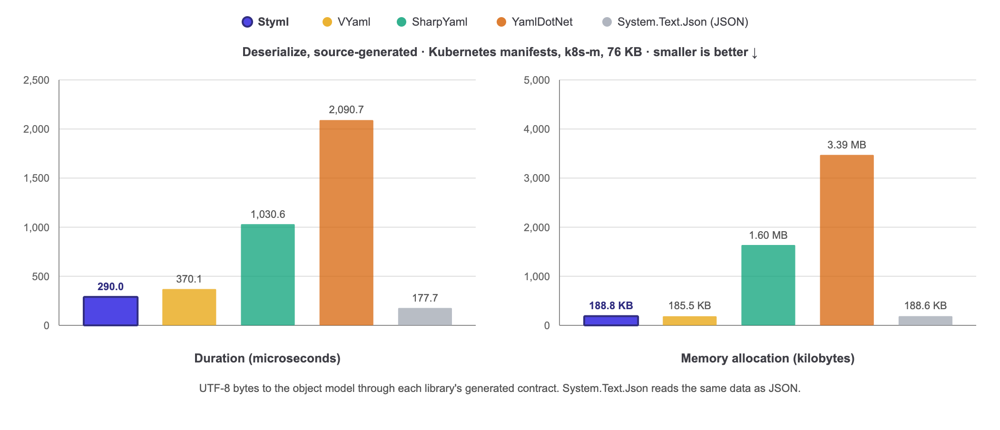
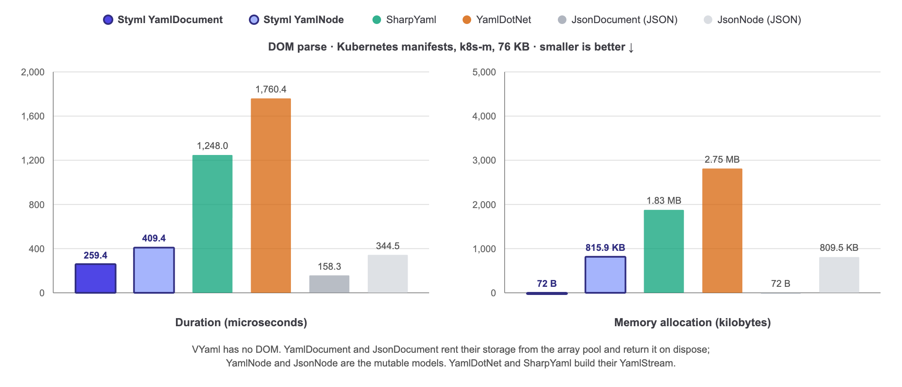

# Styml

**The System.Text.Json API, for YAML.**

Styml is a YAML 1.2 library for .NET: a reader, a writer, a document model and a serializer with reflection and source
generation. It is System.Text.Json's code and API, carried over to YAML, so code written against System.Text.Json reads
the same with `Yaml` in place of `Json`.

```csharp
using System.Text.Yaml;
using System.Text.Yaml.Serialization;

var service = new Service("web", "nginx:1.27", [80, 443], new() { ["TIER"] = "front", ["REPLICAS"] = "3" });

string yaml = YamlSerializer.Serialize(service);
// Name: web
// Image: nginx:1.27
// Ports:
// - 80
// - 443
// Environment:
//   TIER: front
//   REPLICAS: "3"

Service? back = YamlSerializer.Deserialize<Service>(yaml);

// The same with a source-generated context, for trimming and Native AOT.
string generated = YamlSerializer.Serialize(service, AppYamlContext.Default.Service);

public record Service(string Name, string Image, int[] Ports, Dictionary<string, string> Environment);

[YamlSerializable(typeof(Service))]
internal partial class AppYamlContext : YamlSerializerContext;
```

`"3"` is quoted because a plain `3` would read back as a number; the writer quotes exactly what YAML would otherwise
resolve to another type.

## Relationship with System.Text.Json

Styml is a clone of System.Text.Json from [dotnet/runtime](https://github.com/dotnet/runtime) at tag `v11.0.0`
(commit `deae2e32bf0e`), renamed and adapted to YAML 1.2. The import, the rename and every local change are recorded in
[UPSTREAM.md](UPSTREAM.md).

- **The same API shape:** `YamlSerializer`, `YamlSerializerOptions`, `Utf8YamlReader`, `Utf8YamlWriter`,
  `YamlDocument` and `YamlElement`, `YamlNode` and its `YamlObject`, `YamlArray` and `YamlValue`, `YamlConverter<T>`,
  the contract model (`YamlTypeInfo`, resolvers, modifiers), naming policies, polymorphism attributes, and the source
  generator (`YamlSerializerContext`, `[YamlSerializable]`, `[YamlSourceGenerationOptions]`).
- **The namespace is `System.Text.Yaml`**, in the `Styml` package and assembly, so it sits next to System.Text.Json in
  the same application without conflict.
- **What YAML adds:**
  - anchors and aliases, read everywhere and written by `ReferenceHandler.Preserve` (in place of `$id` and `$ref`),
    with bounds on alias expansion;
  - tags, including tag-based polymorphism (`[YamlTagMapping]`) and `%TAG` directives;
  - block and flow styles, scalar styles (plain, single-quoted, double-quoted, literal, folded) per member or by
    default, and comments written from `[YamlComment]`;
  - schemas: the YAML 1.2 core schema by default, the JSON and failsafe schemas, and an opt-in YAML 1.1 schema;
  - merge keys (`<<`), opt-in;
  - collection keys (`? [a, b]: v`) in the DOM and the serializer;
  - multi-document streams (`---`), and the duplicate-key policy (an error by default, as YAML requires).
- **What differs from System.Text.Json:**
  - the writer writes block-style YAML by default; a JSON-compatible style is an option (`YamlWriterOptions.Style`);
  - the reader reads YAML 1.2, of which JSON is a subset: a plain scalar is text until a typed read asks for a number
    or a boolean, empty input reads as no value, and several top-level values are documents;
  - the APIs that were obsolete upstream (`IgnoreNullValues`, `AddContext`) are removed.

Styml is an independent project. It is not a Microsoft or .NET Foundation product, and it is not supported by them.
Most of its code is System.Text.Json's, under the MIT license of the .NET Foundation and its contributors; see
[LICENSE](LICENSE) and [THIRD-PARTY-NOTICES.txt](THIRD-PARTY-NOTICES.txt).

## Versions and package feeds

| Source | Purpose | Package feed |
| --- | --- | --- |
| `v*.*.*` | Versioned releases | [](https://www.nuget.org/packages/Styml) |
| `main` branch | Development previews | [](https://feedz.io/org/sebastienros/repository/styml/packages/Styml) |

For development previews, add Feedz alongside NuGet.org:

```sh
dotnet nuget add source https://f.feedz.io/sebastienros/styml/nuget/index.json --name styml-preview
dotnet add package Styml --prerelease
```

## Features

- **Serializer:** reflection and source-generated contracts, the options and attributes of System.Text.Json
  (naming policies, ignore conditions, required and init members, constructors, polymorphism, number handling,
  reference handling), async and streaming APIs, and YAML's tags, anchors, merge keys and collection keys.
- **Reader:** `Utf8YamlReader`, a forward-only reader over UTF-8 spans and multi-segment sequences, with YAML's token
  information (scalar style, anchor, tag, alias, key kind) next to System.Text.Json's.
- **Writer:** `Utf8YamlWriter`, block style by default, flow collections, scalar styles, anchors, tags, comments,
  explicit keys, and a JSON-compatible style.
- **DOM:** the read-only `YamlDocument` and the mutable `YamlNode`, which keep anchors, tags and styles for write-back.
- **YAML 1.2 conformance:** see below.

## YAML conformance

Styml runs the [yaml-test-suite](https://github.com/yaml/yaml-test-suite) (release `data-2022-01-17`, 402 cases) in
its tests:

- all **308 valid cases** are accepted, each with the suite's expected event trace (`%TAG` handles expanded);
- all **94 error cases** are rejected;
- every valid case, written back in block style, reads again with the same events.

The expectation lists in `test/Styml.Yaml.Tests/YamlTestSuite` are empty: no case is an exception.

## Target frameworks

The package targets `net11.0`, `net10.0` and `netstandard2.0` (which covers .NET Framework 4.6.2 and later). The tests
run on net11.0, net10.0 and, through the netstandard2.0 asset, net481.

## Trimming and Native AOT

On net10.0 and net11.0 the library is trimmable and AOT-compatible, with the analyzers on. With a source-generated
`YamlSerializerContext`, serialization needs no reflection; set `YamlSerializerIsReflectionEnabledByDefault` to `false`
in the project file to turn reflection-based serialization off, as with System.Text.Json.
`samples/AotSmoke` is published trimmed and as Native AOT, with warnings as errors, before every release.

## Benchmarks

Styml against YamlDotNet 18.1.0, SharpYaml 3.17.0 and VYaml 1.6.1, with System.Text.Json reading or writing the
same data as JSON as the reference. Five medium documents from `bench/corpus` (25 to 96 KB: a Compose file, Kubernetes
manifests, an OpenAPI description, a list of records, a CI workflow); .NET 11.0.0 on an Apple M4 Pro (macOS 15.8, Arm64);
BenchmarkDotNet 0.16.0-preview.2, ShortRun with 3 launches; run on 2026-11-23 on the published commit. The charts and
the first two tables are the Kubernetes manifests (`k8s-m`, 76 KB).

<!-- panel:charts -->




<!-- /panel:charts -->

<!-- panel:pivot -->
Mean time on k8s-m (microseconds; smaller is better):

| Scenario | Styml | VYaml | SharpYaml | YamlDotNet | System.Text.Json |
| --- | ---: | ---: | ---: | ---: | ---: |
| Deserialize, source-generated | **290.0** | 370.1 | 1,030.6 | 2,090.7 | 177.7 |
| Deserialize, reflection | **324.0** | n/a | 1,563.8 | 2,733.2 | 198.0 |
| Serialize, source-generated | **53.7** | 100.2 | 182.4 | 1,832.3 | 39.5 |
| Serialize, reused buffer | **50.8** | 100.2 | 182.4 | — | — |
| DOM parse (`YamlDocument`, `JsonDocument`) | **259.4** | n/a | 1,248.0 | 1,760.4 | 158.3 |
| DOM parse, mutable (`YamlNode`, `JsonNode`) | **409.4** | n/a | 1,248.0 | 1,760.4 | 344.5 |
| Tokenize | **189.7** | 309.0 | 891.0 | 1,360.2 | 119.1 |

Allocated on k8s-m (smaller is better):

| Scenario | Styml | VYaml | SharpYaml | YamlDotNet | System.Text.Json |
| --- | ---: | ---: | ---: | ---: | ---: |
| Deserialize, source-generated | **188.8 KB** | 185.5 KB | 1.60 MB | 3.39 MB | 188.6 KB |
| Deserialize, reflection | **188.8 KB** | n/a | 1.84 MB | 3.60 MB | 188.6 KB |
| Serialize, source-generated | **73.1 KB** | 6.2 KB | 25.3 KB | 2.06 MB | 55.0 KB |
| Serialize, reused buffer | **0 B** | 6.2 KB | 25.3 KB | — | — |
| DOM parse (`YamlDocument`, `JsonDocument`) | **72 B** | n/a | 1.83 MB | 2.75 MB | 72 B |
| DOM parse, mutable (`YamlNode`, `JsonNode`) | **815.9 KB** | n/a | 1.83 MB | 2.75 MB | 809.5 KB |
| Tokenize | **0 B** | 1.1 KB | 1.26 MB | 1.78 MB | 0 B |

Time against Styml's, the geometric mean over the five documents (below 1 is faster than Styml):

| Scenario | Styml | VYaml | SharpYaml | YamlDotNet | System.Text.Json |
| --- | ---: | ---: | ---: | ---: | ---: |
| Deserialize, source-generated | **1.00×** | 1.42× | 3.66× | 7.26× | 0.65× |
| Deserialize, reflection | **1.00×** | n/a | 4.57× | 8.62× | 0.62× |
| Serialize, source-generated | **1.00×** | 1.76× | 2.92× | 28.06× | 0.66× |
| Serialize, reused buffer | **1.00×** | 1.89× | 3.15× | — | — |
| DOM parse (`YamlDocument`, `JsonDocument`) | **1.00×** | n/a | 4.86× | 6.99× | 0.59× |
| DOM parse, mutable (`YamlNode`, `JsonNode`) | **1.00×** | n/a | 2.76× | 3.97× | 0.78× |
| Tokenize | **1.00×** | 1.79× | 4.95× | 7.43× | 0.65× |
<!-- /panel:pivot -->

On every document and in every scenario, each YAML library takes at least 1.28 times Styml's time. System.Text.Json
on the JSON twin takes 0.54 to 0.77 of it, except in the mutable DOM, where `JsonNode` takes 0.63 to 1.06 of
`YamlNode`'s time.

Like-for-like notes:

- **Serialize:** Styml's main row returns a new `byte[]`; SharpYaml and VYaml write into reused buffers (SharpYaml's is
  UTF-16), and "reused buffer" is Styml's equivalent row. YamlDotNet returns a `string`.
- **Tokenize and DOM parse:** YamlDotNet and SharpYaml read a string decoded in setup; Styml, VYaml and
  System.Text.Json read UTF-8 bytes. VYaml has no DOM and no reflection serializer.
- **DOM parse:** `YamlDocument` and `JsonDocument` rent their storage from the array pool and return it on dispose, so
  their allocation is the document object alone. YamlDotNet and SharpYaml have one model, `YamlStream`, shown on both
  DOM rows.

Every row of every document, the two other charts, error columns, method and how to run it:
[docs/benchmarks](docs/benchmarks/README.md).

## Building and testing

The repository builds with the .NET SDK named in `global.json`.

```sh
dotnet build Styml.slnx -c Release
eng/test/run-tests.sh net11.0
```

`eng/test/run-tests.sh` runs upstream's test filter; `STYML_TEST_WRITER=json` runs the same tests with the
JSON-compatible writer default. The three `Microsoft.DotNet.*` test packages come from dnceng's public `dotnet-eng`
feed: [docs/release.md](docs/release.md) gives the restore command, what CI runs, and how a release is made.

## License and credits

Styml is released under the [MIT license](LICENSE). Copyright (c) 2026 Sébastien Ros; portions Copyright (c) .NET
Foundation and Contributors. Styml is derived from System.Text.Json in dotnet/runtime, whose code, tests and
documentation it keeps with their notices ([THIRD-PARTY-NOTICES.txt](THIRD-PARTY-NOTICES.txt),
[UPSTREAM.md](UPSTREAM.md)). The YAML conformance data is the yaml-test-suite's, under its MIT license. The artwork is
described in [assets/README.md](assets/README.md).
