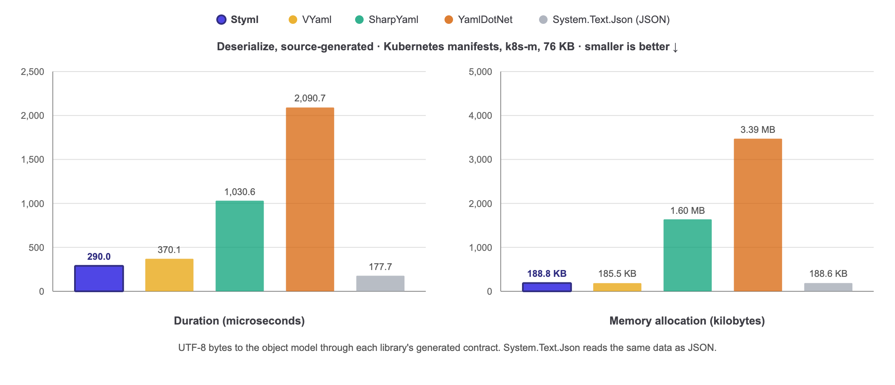
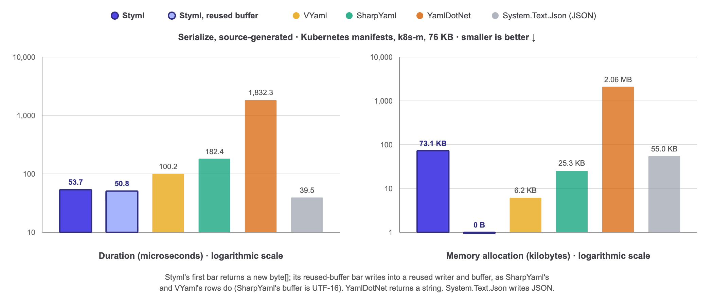
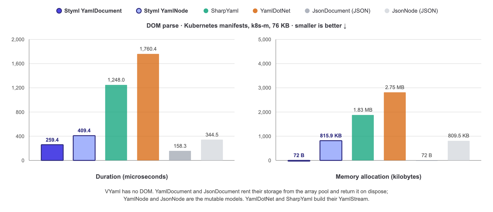

Styml keeps System.Text.Json's design: a UTF-8 reader and writer over spans, pooled buffers, a document that rents its
storage, and cached contracts. In the benchmarks below it is the fastest of the .NET YAML libraries in every scenario,
and System.Text.Json, handling the same data as JSON, is the reference it is measured against.

## Benchmarks

Styml against YamlDotNet, SharpYaml and VYaml, with System.Text.Json reading or writing the same data as JSON as the
reference, measured with BenchmarkDotNet on the documents of `bench/corpus` (a Compose file, Kubernetes manifests, an
OpenAPI description, a list of records, a CI workflow). The charts and the first two tables are the Kubernetes
manifests (`k8s-m`); the versions, the machine and the date of the run are in the README and in
docs/benchmarks. These results are copied from the README, which the benchmark tooling updates:

<!-- include:benchmarks -->

Mean time on k8s-m (microseconds; smaller is better):

| Scenario | Styml | VYaml | SharpYaml | YamlDotNet | System.Text.Json |
| --- | ---: | ---: | ---: | ---: | ---: |
| Deserialize, source-generated | **290.0** | 370.1 | 1,030.6 | 2,090.7 | 177.7 |
| Deserialize, reflection | **324.0** | n/a | 1,563.8 | 2,733.2 | 198.0 |
| Serialize, source-generated | **53.7** | 100.2 | 182.4 | 1,832.3 | 39.5 |
| Serialize, reused buffer | **50.8** | 100.2 | 182.4 | — | — |
| DOM parse (`YamlDocument`, `JsonDocument`) | **259.4** | n/a | 1,248.0 | 1,760.4 | 158.3 |
| DOM parse, mutable (`YamlNode`, `JsonNode`) | **409.4** | n/a | 1,248.0 | 1,760.4 | 344.5 |
| Tokenize | **189.7** | 309.0 | 891.0 | 1,360.2 | 119.1 |

Allocated on k8s-m (smaller is better):

| Scenario | Styml | VYaml | SharpYaml | YamlDotNet | System.Text.Json |
| --- | ---: | ---: | ---: | ---: | ---: |
| Deserialize, source-generated | **188.8 KB** | 185.5 KB | 1.60 MB | 3.39 MB | 188.6 KB |
| Deserialize, reflection | **188.8 KB** | n/a | 1.84 MB | 3.60 MB | 188.6 KB |
| Serialize, source-generated | **73.1 KB** | 6.2 KB | 25.3 KB | 2.06 MB | 55.0 KB |
| Serialize, reused buffer | **0 B** | 6.2 KB | 25.3 KB | — | — |
| DOM parse (`YamlDocument`, `JsonDocument`) | **72 B** | n/a | 1.83 MB | 2.75 MB | 72 B |
| DOM parse, mutable (`YamlNode`, `JsonNode`) | **815.9 KB** | n/a | 1.83 MB | 2.75 MB | 809.5 KB |
| Tokenize | **0 B** | 1.1 KB | 1.26 MB | 1.78 MB | 0 B |

Time against Styml's, the geometric mean over the five documents (below 1 is faster than Styml):

| Scenario | Styml | VYaml | SharpYaml | YamlDotNet | System.Text.Json |
| --- | ---: | ---: | ---: | ---: | ---: |
| Deserialize, source-generated | **1.00×** | 1.42× | 3.66× | 7.26× | 0.65× |
| Deserialize, reflection | **1.00×** | n/a | 4.57× | 8.62× | 0.62× |
| Serialize, source-generated | **1.00×** | 1.76× | 2.92× | 28.06× | 0.66× |
| Serialize, reused buffer | **1.00×** | 1.89× | 3.15× | — | — |
| DOM parse (`YamlDocument`, `JsonDocument`) | **1.00×** | n/a | 4.86× | 6.99× | 0.59× |
| DOM parse, mutable (`YamlNode`, `JsonNode`) | **1.00×** | n/a | 2.76× | 3.97× | 0.78× |
| Tokenize | **1.00×** | 1.79× | 4.95× | 7.43× | 0.65× |
<!-- /include:benchmarks -->

Every row of every document, the method and how to run the benchmarks:
[docs/benchmarks](https://github.com/sebastienros/styml/blob/main/docs/benchmarks/README.md).

## Keep it fast

- **Reuse the options.** `YamlSerializerOptions` caches the contract of each type: a new instance per call builds
  them again. Keep one per configuration, in a static field or in dependency injection.
- **Use a source-generated context.** It builds contracts at compile time, starts faster and allocates less:
  [Source generation](source-generation.md).
- **Read and write UTF-8.** `SerializeToUtf8Bytes`, `Deserialize(ReadOnlySpan<byte>)` and the stream overloads skip
  the conversion from and to UTF-16 strings.
- **Read with YamlDocument.** It allocates the document object alone, and returns its storage to the pool on
  `Dispose`. `YamlNode` builds objects, for documents you change.
- **Stream documents.** `DeserializeAsyncEnumerable` reads a stream of documents one at a time.
