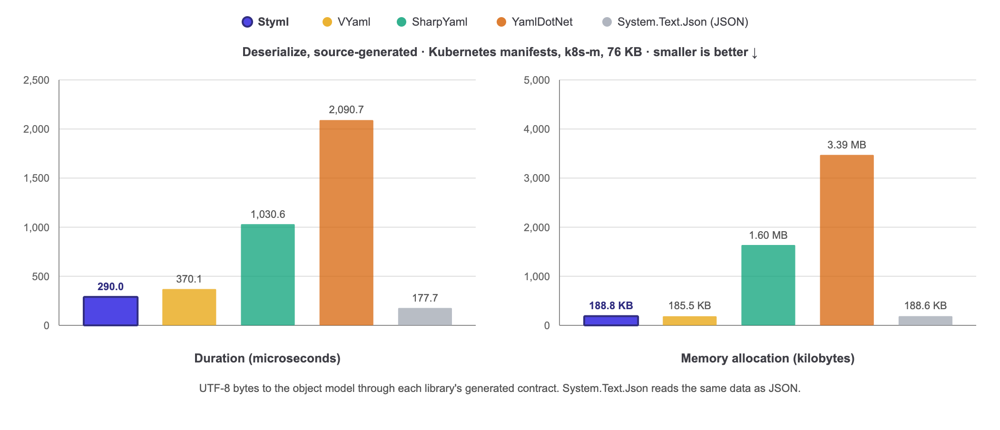
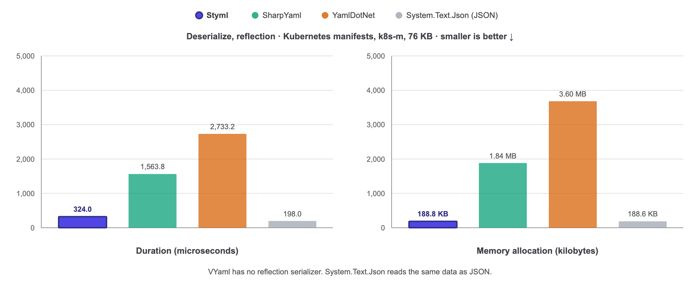
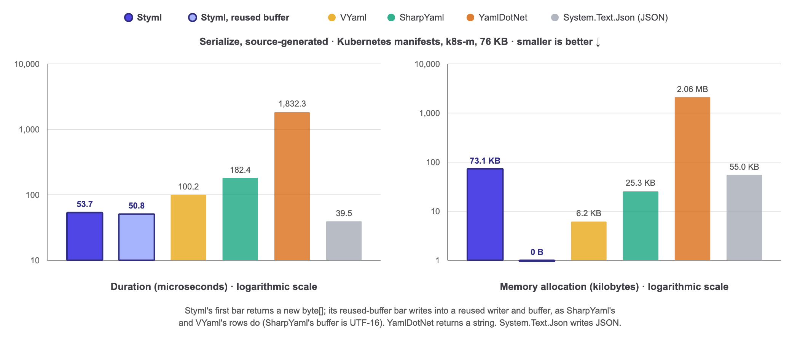
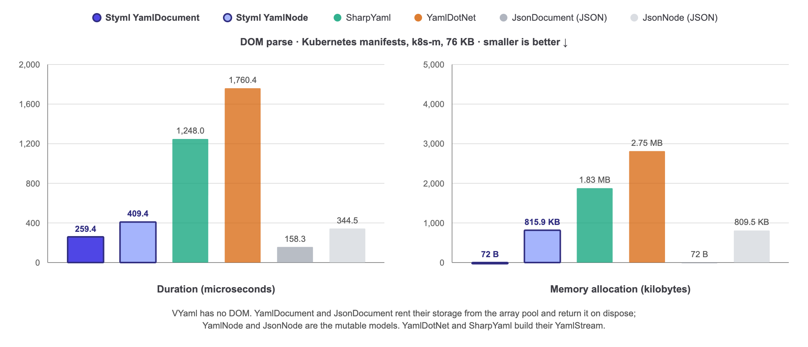
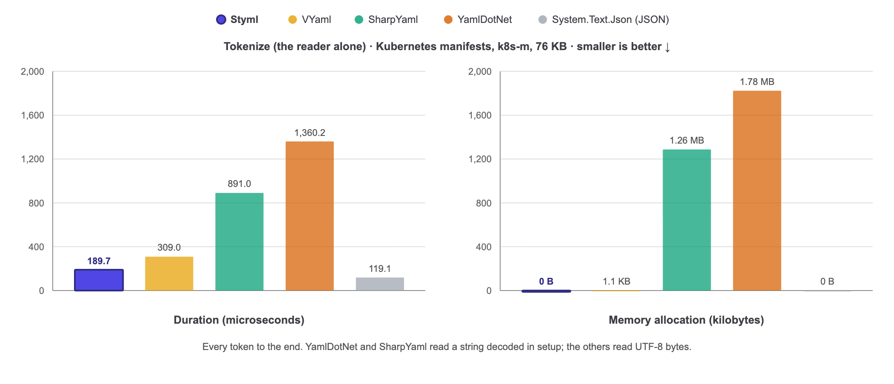

# Benchmarks

Styml against the YAML libraries for .NET, with System.Text.Json on the equivalent JSON as the ceiling: what reading
and writing the same data costs when it is YAML instead of JSON. The README carries the summary; this page has every
row.

## What is measured

| | |
| --- | --- |
| Libraries | Styml (this commit), YamlDotNet 18.1.0, SharpYaml 3.17.0, VYaml 1.6.1, System.Text.Json 11.0.0 (in-box) |
| Documents | `bench/corpus`, the five medium documents: `compose-m` (a Compose file, 44 KB), `k8s-m` (Kubernetes manifests, 76 KB), `openapi-m` (an OpenAPI description, 91 KB), `records-m` (a list of records, 96 KB), `workflow-m` (a CI workflow, 25 KB), each with a JSON twin of the same data |
| Machine | Apple M4 Pro (14 cores, 48 GB), macOS Sequoia 15.8.3 |
| Runtime | .NET 11.0.0 (SDK 11.0.100), Arm64 RyuJIT |
| Harness | BenchmarkDotNet 0.16.0-preview.2, ShortRun job (3 warm-up and 3 measured iterations) with 3 launches, out of process, memory diagnoser on |
| Date and commit | 2026-11-23, the published commit (the tree gated before publication) |

Each scenario reads or writes one whole document per call:

- **Deserialize, source-generated:** UTF-8 bytes to the object model, through each library's generated contract
  (Styml's `YamlSerializerContext`, YamlDotNet's static context, SharpYaml's generated serializer, VYaml's generated
  formatters, System.Text.Json's `JsonSerializerContext`).
- **Deserialize, reflection:** the same with reflection. VYaml has no reflection serializer.
- **Serialize, source-generated:** the object model to YAML (System.Text.Json: to JSON). Styml's main row returns a new
  `byte[]` (`YamlSerializer.SerializeToUtf8Bytes`); its "reused writer and buffer" row writes into a reused
  `Utf8YamlWriter` and buffer, the like-for-like of SharpYaml's and VYaml's rows, which write into reused buffers
  (SharpYaml's is UTF-16). YamlDotNet returns a `string`.
- **DOM parse:** a whole document into each library's document model: Styml's `YamlDocument` and `YamlNode`,
  YamlDotNet's `YamlStream`, SharpYaml's `YamlStream`, System.Text.Json's `JsonDocument` and `JsonNode`. VYaml has no
  DOM. `YamlDocument` and `JsonDocument` rent their storage from the array pool and return it on dispose, so their
  allocation is the document object alone. The time ratios of this scenario are against `YamlDocument`.
- **Tokenize:** the reader alone, every token to the end. YamlDotNet and SharpYaml read the document as a string
  decoded in setup; Styml, VYaml and System.Text.Json read UTF-8 bytes.

Every library runs with its default options; Styml writes block style. A setup check runs before any timing and fails
the run if two libraries do not read or write the same data. The ratio columns compare each row with Styml's on the
same document: below 1 is faster or smaller than Styml.

## How to run

```sh
dotnet build bench/Styml.Benchmarks -c Release
sh bench/run-panel.sh
python3 bench/report-panel.py bench/results/Panel/net11.0/results full
python3 bench/report-panel.py bench/results/Panel/net11.0/results pivot README.md src/Styml/PACKAGE.md
python3 bench/charts/generate_charts.py --readme README.md --page docs/benchmarks/README.md
```

`bench/run-panel.sh` waits for a quiet machine (1-minute load below 6, 5-minute below 8) before each class and logs the
loads. The numbers on this page are one such run; ShortRun's error columns are wide by design, so a difference of a few
percent between two libraries is within the noise.

## Charts

One chart per scenario on the Kubernetes manifests (`k8s-m`), made by `bench/charts/generate_charts.py` from the run's
reports: duration and allocation, one bar per library, Styml in indigo and System.Text.Json in grey as the reference.

<!-- panel:charts -->









<!-- /panel:charts -->

## Results

### Deserialize, source-generated

| Document | Library | Mean (µs) | Error (µs) | Time vs Styml | Allocated | Allocated vs Styml |
| --- | --- | ---: | ---: | ---: | ---: | ---: |
| compose-m | Styml | 150.0 | 4.9 | 1.00 | 151.7 KB | 1.00 |
| compose-m | YamlDotNet | 1,050.1 | 51.0 | 7.00 | 1.78 MB | 12.04 |
| compose-m | SharpYaml | 562.5 | 8.1 | 3.75 | 861.3 KB | 5.68 |
| compose-m | VYaml | 208.5 | 4.1 | 1.39 | 151.2 KB | 1.00 |
| compose-m | System.Text.Json (JSON input) | 93.5 | 0.8 | 0.62 | 151.6 KB | 1.00 |
| k8s-m | Styml | 290.0 | 10.4 | 1.00 | 188.8 KB | 1.00 |
| k8s-m | YamlDotNet | 2,090.7 | 80.9 | 7.21 | 3.39 MB | 18.40 |
| k8s-m | SharpYaml | 1,030.6 | 56.5 | 3.55 | 1.60 MB | 8.67 |
| k8s-m | VYaml | 370.1 | 15.1 | 1.28 | 185.5 KB | 0.98 |
| k8s-m | System.Text.Json (JSON input) | 177.7 | 2.6 | 0.61 | 188.6 KB | 1.00 |
| openapi-m | Styml | 418.8 | 39.5 | 1.00 | 314.8 KB | 1.00 |
| openapi-m | YamlDotNet | 2,870.2 | 44.7 | 6.85 | 4.81 MB | 15.64 |
| openapi-m | SharpYaml | 1,450.7 | 81.0 | 3.46 | 2.35 MB | 7.66 |
| openapi-m | VYaml | 562.5 | 27.7 | 1.34 | 311.4 KB | 0.99 |
| openapi-m | System.Text.Json (JSON input) | 270.2 | 7.2 | 0.65 | 314.6 KB | 1.00 |
| records-m | Styml | 465.6 | 4.1 | 1.00 | 228.0 KB | 1.00 |
| records-m | YamlDotNet | 3,772.5 | 192.4 | 8.10 | 6.31 MB | 28.32 |
| records-m | SharpYaml | 1,808.2 | 40.2 | 3.88 | 2.92 MB | 13.09 |
| records-m | VYaml | 791.0 | 134.2 | 1.70 | 227.5 KB | 1.00 |
| records-m | System.Text.Json (JSON input) | 350.2 | 18.4 | 0.75 | 228.0 KB | 1.00 |
| workflow-m | Styml | 90.8 | 2.2 | 1.00 | 89.6 KB | 1.00 |
| workflow-m | YamlDotNet | 654.5 | 96.2 | 7.21 | 983.7 KB | 10.98 |
| workflow-m | SharpYaml | 331.4 | 20.9 | 3.65 | 542.7 KB | 6.06 |
| workflow-m | VYaml | 129.6 | 1.1 | 1.43 | 83.5 KB | 0.93 |
| workflow-m | System.Text.Json (JSON input) | 55.7 | 0.7 | 0.61 | 84.9 KB | 0.95 |

### Deserialize, reflection

| Document | Library | Mean (µs) | Error (µs) | Time vs Styml | Allocated | Allocated vs Styml |
| --- | --- | ---: | ---: | ---: | ---: | ---: |
| compose-m | Styml | 155.1 | 3.0 | 1.00 | 151.7 KB | 1.00 |
| compose-m | YamlDotNet | 1,297.5 | 11.4 | 8.36 | 1.86 MB | 12.55 |
| compose-m | SharpYaml | 709.5 | 9.3 | 4.57 | 943.0 KB | 6.22 |
| compose-m | System.Text.Json (JSON input) | 96.1 | 0.8 | 0.62 | 151.6 KB | 1.00 |
| k8s-m | Styml | 324.0 | 43.0 | 1.00 | 188.8 KB | 1.00 |
| k8s-m | YamlDotNet | 2,733.2 | 104.3 | 8.44 | 3.60 MB | 19.50 |
| k8s-m | SharpYaml | 1,563.8 | 187.5 | 4.83 | 1.84 MB | 9.98 |
| k8s-m | System.Text.Json (JSON input) | 198.0 | 27.7 | 0.61 | 188.6 KB | 1.00 |
| openapi-m | Styml | 443.6 | 35.3 | 1.00 | 314.8 KB | 1.00 |
| openapi-m | YamlDotNet | 3,721.7 | 77.2 | 8.39 | 5.00 MB | 16.27 |
| openapi-m | SharpYaml | 1,851.6 | 126.1 | 4.17 | 2.68 MB | 8.71 |
| openapi-m | System.Text.Json (JSON input) | 272.1 | 9.0 | 0.61 | 314.6 KB | 1.00 |
| records-m | Styml | 526.2 | 66.4 | 1.00 | 228.0 KB | 1.00 |
| records-m | YamlDotNet | 5,284.3 | 693.6 | 10.04 | 6.36 MB | 28.56 |
| records-m | SharpYaml | 2,279.4 | 141.5 | 4.33 | 3.48 MB | 15.64 |
| records-m | System.Text.Json (JSON input) | 339.3 | 4.1 | 0.64 | 228.0 KB | 1.00 |
| workflow-m | Styml | 91.7 | 1.1 | 1.00 | 89.6 KB | 1.00 |
| workflow-m | YamlDotNet | 735.9 | 19.5 | 8.03 | 1.13 MB | 12.91 |
| workflow-m | SharpYaml | 456.7 | 10.9 | 4.98 | 615.7 KB | 6.88 |
| workflow-m | System.Text.Json (JSON input) | 56.8 | 1.1 | 0.62 | 84.9 KB | 0.95 |

### Serialize, source-generated

| Document | Library | Mean (µs) | Error (µs) | Time vs Styml | Allocated | Allocated vs Styml |
| --- | --- | ---: | ---: | ---: | ---: | ---: |
| compose-m | Styml | 35.9 | 0.4 | 1.00 | 41.3 KB | 1.00 |
| compose-m | Styml, reused writer and buffer | 38.2 | 4.0 | 1.06 | 0 B | 0.00 |
| compose-m | YamlDotNet | 990.2 | 128.5 | 27.59 | 1.03 MB | 25.48 |
| compose-m | SharpYaml | 130.0 | 2.2 | 3.62 | 472 B | 0.01 |
| compose-m | VYaml | 78.8 | 6.2 | 2.19 | 10.6 KB | 0.26 |
| compose-m | System.Text.Json (JSON output) | 21.6 | 2.2 | 0.60 | 36.3 KB | 0.88 |
| k8s-m | Styml | 53.7 | 0.3 | 1.00 | 73.1 KB | 1.00 |
| k8s-m | Styml, reused writer and buffer | 50.8 | 0.4 | 0.95 | 0 B | 0.00 |
| k8s-m | YamlDotNet | 1,832.3 | 53.0 | 34.15 | 2.06 MB | 28.86 |
| k8s-m | SharpYaml | 182.4 | 2.1 | 3.40 | 25.3 KB | 0.35 |
| k8s-m | VYaml | 100.2 | 3.8 | 1.87 | 6.2 KB | 0.08 |
| k8s-m | System.Text.Json (JSON output) | 39.5 | 0.1 | 0.74 | 55.0 KB | 0.75 |
| openapi-m | Styml | 94.4 | 16.2 | 1.00 | 85.9 KB | 1.00 |
| openapi-m | Styml, reused writer and buffer | 71.4 | 1.2 | 0.76 | 0 B | 0.00 |
| openapi-m | YamlDotNet | 3,102.2 | 545.2 | 32.88 | 3.51 MB | 41.79 |
| openapi-m | SharpYaml | 242.3 | 10.1 | 2.57 | 992 B | 0.01 |
| openapi-m | VYaml | 155.2 | 9.1 | 1.64 | 12.2 KB | 0.14 |
| openapi-m | System.Text.Json (JSON output) | 51.0 | 1.2 | 0.54 | 62.9 KB | 0.73 |
| records-m | Styml | 140.6 | 10.5 | 1.00 | 91.8 KB | 1.00 |
| records-m | Styml, reused writer and buffer | 123.9 | 1.5 | 0.88 | 0 B | 0.00 |
| records-m | YamlDotNet | 2,952.8 | 100.6 | 21.00 | 3.39 MB | 37.86 |
| records-m | SharpYaml | 321.2 | 4.5 | 2.28 | 472 B | 0.01 |
| records-m | VYaml | 199.8 | 3.6 | 1.42 | 12.2 KB | 0.13 |
| records-m | System.Text.Json (JSON output) | 106.9 | 1.5 | 0.76 | 89.6 KB | 0.98 |
| workflow-m | Styml | 23.3 | 0.3 | 1.00 | 22.5 KB | 1.00 |
| workflow-m | Styml, reused writer and buffer | 23.8 | 0.3 | 1.02 | 0 B | 0.00 |
| workflow-m | YamlDotNet | 623.1 | 94.2 | 26.76 | 692.4 KB | 30.79 |
| workflow-m | SharpYaml | 68.5 | 1.7 | 2.94 | 9.5 KB | 0.42 |
| workflow-m | VYaml | 40.7 | 1.2 | 1.75 | 3.3 KB | 0.15 |
| workflow-m | System.Text.Json (JSON output) | 15.4 | 0.5 | 0.66 | 19.7 KB | 0.88 |

### DOM parse

| Document | Library | Mean (µs) | Error (µs) | Time vs Styml | Allocated | Allocated vs Styml |
| --- | --- | ---: | ---: | ---: | ---: | ---: |
| compose-m | Styml `YamlDocument` | 120.3 | 6.9 | 1.00 | 72 B | 1.00 |
| compose-m | System.Text.Json `JsonDocument` (JSON input) | 69.3 | 0.7 | 0.58 | 72 B | 1.00 |
| compose-m | Styml `YamlNode` | 197.0 | 7.2 | 1.64 | 395.9 KB | 5631.11 |
| compose-m | YamlDotNet | 860.2 | 24.7 | 7.15 | 1.37 MB | 20000.11 |
| compose-m | SharpYaml | 610.6 | 10.9 | 5.07 | 942.8 KB | 13408.78 |
| compose-m | System.Text.Json `JsonNode` (JSON input) | 135.7 | 2.5 | 1.13 | 379.0 KB | 5390.33 |
| k8s-m | Styml `YamlDocument` | 259.4 | 5.1 | 1.00 | 72 B | 1.00 |
| k8s-m | System.Text.Json `JsonDocument` (JSON input) | 158.3 | 1.1 | 0.61 | 72 B | 1.00 |
| k8s-m | Styml `YamlNode` | 409.4 | 2.7 | 1.58 | 815.9 KB | 11604.33 |
| k8s-m | YamlDotNet | 1,760.4 | 14.1 | 6.79 | 2.75 MB | 40028.22 |
| k8s-m | SharpYaml | 1,248.0 | 42.2 | 4.81 | 1.83 MB | 26714.56 |
| k8s-m | System.Text.Json `JsonNode` (JSON input) | 344.5 | 5.9 | 1.33 | 809.5 KB | 11512.93 |
| openapi-m | Styml `YamlDocument` | 370.9 | 49.6 | 1.00 | 72 B | 1.00 |
| openapi-m | System.Text.Json `JsonDocument` (JSON input) | 206.5 | 2.5 | 0.56 | 72 B | 1.00 |
| openapi-m | Styml `YamlNode` | 618.0 | 37.2 | 1.67 | 1.18 MB | 17126.79 |
| openapi-m | YamlDotNet | 2,536.7 | 128.1 | 6.84 | 3.96 MB | 57600.78 |
| openapi-m | SharpYaml | 1,702.1 | 33.8 | 4.59 | 2.65 MB | 38640.78 |
| openapi-m | System.Text.Json `JsonNode` (JSON input) | 652.8 | 16.7 | 1.76 | 1.15 MB | 16712.35 |
| records-m | Styml `YamlDocument` | 392.9 | 5.1 | 1.00 | 72 B | 1.00 |
| records-m | System.Text.Json `JsonDocument` (JSON input) | 260.4 | 1.3 | 0.66 | 72 B | 1.00 |
| records-m | Styml `YamlNode` | 971.3 | 127.7 | 2.47 | 1.43 MB | 20797.79 |
| records-m | YamlDotNet | 3,379.8 | 37.9 | 8.60 | 5.11 MB | 74475.44 |
| records-m | SharpYaml | 2,308.2 | 58.4 | 5.88 | 3.45 MB | 50255.44 |
| records-m | System.Text.Json `JsonNode` (JSON input) | 750.1 | 6.2 | 1.91 | 1.37 MB | 19911.10 |
| workflow-m | Styml `YamlDocument` | 81.9 | 6.5 | 1.00 | 13.7 KB | 1.00 |
| workflow-m | System.Text.Json `JsonDocument` (JSON input) | 46.0 | 4.4 | 0.56 | 72 B | 0.01 |
| workflow-m | Styml `YamlNode` | 130.5 | 8.3 | 1.59 | 271.0 KB | 19.74 |
| workflow-m | YamlDotNet | 477.6 | 13.1 | 5.84 | 824.5 KB | 60.06 |
| workflow-m | SharpYaml | 337.8 | 11.1 | 4.13 | 587.2 KB | 42.78 |
| workflow-m | System.Text.Json `JsonNode` (JSON input) | 81.8 | 0.5 | 1.00 | 221.1 KB | 16.11 |

### Tokenize (reader only)

| Document | Library | Mean (µs) | Error (µs) | Time vs Styml | Allocated | Allocated vs Styml |
| --- | --- | ---: | ---: | ---: | ---: | ---: |
| compose-m | Styml | 93.8 | 1.5 | 1.00 | 0 B | ? |
| compose-m | YamlDotNet | 716.9 | 5.4 | 7.64 | 949.2 KB | ? |
| compose-m | SharpYaml | 488.3 | 5.3 | 5.21 | 678.6 KB | ? |
| compose-m | VYaml | 166.1 | 3.1 | 1.77 | 1.1 KB | ? |
| compose-m | System.Text.Json (JSON input) | 57.0 | 0.8 | 0.61 | 0 B | ? |
| k8s-m | Styml | 189.7 | 4.9 | 1.00 | 0 B | ? |
| k8s-m | YamlDotNet | 1,360.2 | 18.2 | 7.17 | 1.78 MB | ? |
| k8s-m | SharpYaml | 891.0 | 12.8 | 4.70 | 1.26 MB | ? |
| k8s-m | VYaml | 309.0 | 4.0 | 1.63 | 1.1 KB | ? |
| k8s-m | System.Text.Json (JSON input) | 119.1 | 0.9 | 0.63 | 0 B | ? |
| openapi-m | Styml | 262.7 | 4.8 | 1.00 | 0 B | ? |
| openapi-m | YamlDotNet | 1,763.3 | 17.6 | 6.71 | 2.48 MB | ? |
| openapi-m | SharpYaml | 1,139.4 | 11.0 | 4.34 | 1.73 MB | ? |
| openapi-m | VYaml | 421.4 | 6.1 | 1.60 | 1.1 KB | ? |
| openapi-m | System.Text.Json (JSON input) | 161.5 | 1.6 | 0.61 | 0 B | ? |
| records-m | Styml | 297.6 | 6.9 | 1.00 | 0 B | ? |
| records-m | YamlDotNet | 2,447.2 | 207.7 | 8.22 | 3.34 MB | ? |
| records-m | SharpYaml | 1,609.1 | 160.1 | 5.41 | 2.38 MB | ? |
| records-m | VYaml | 612.4 | 43.8 | 2.06 | 1.1 KB | ? |
| records-m | System.Text.Json (JSON input) | 229.2 | 3.4 | 0.77 | 0 B | ? |
| workflow-m | Styml | 54.2 | 0.6 | 1.00 | 0 B | ? |
| workflow-m | YamlDotNet | 406.7 | 3.9 | 7.50 | 548.6 KB | ? |
| workflow-m | SharpYaml | 279.9 | 7.2 | 5.16 | 424.9 KB | ? |
| workflow-m | VYaml | 103.9 | 0.3 | 1.92 | 1.1 KB | ? |
| workflow-m | System.Text.Json (JSON input) | 36.1 | 0.6 | 0.67 | 0 B | ? |

The loads during the run (1-minute and 5-minute averages, from the panel's log): every class started with the 1-minute
load between 3.8 and 5.7; during the deserialize-reflection class the desktop's own processes raised it to 7.5 at the
end. Times are means of 9 measured iterations (3 launches of 3); ShortRun's error columns are wide by design.
